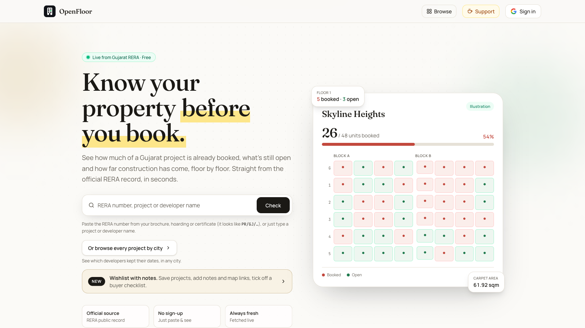
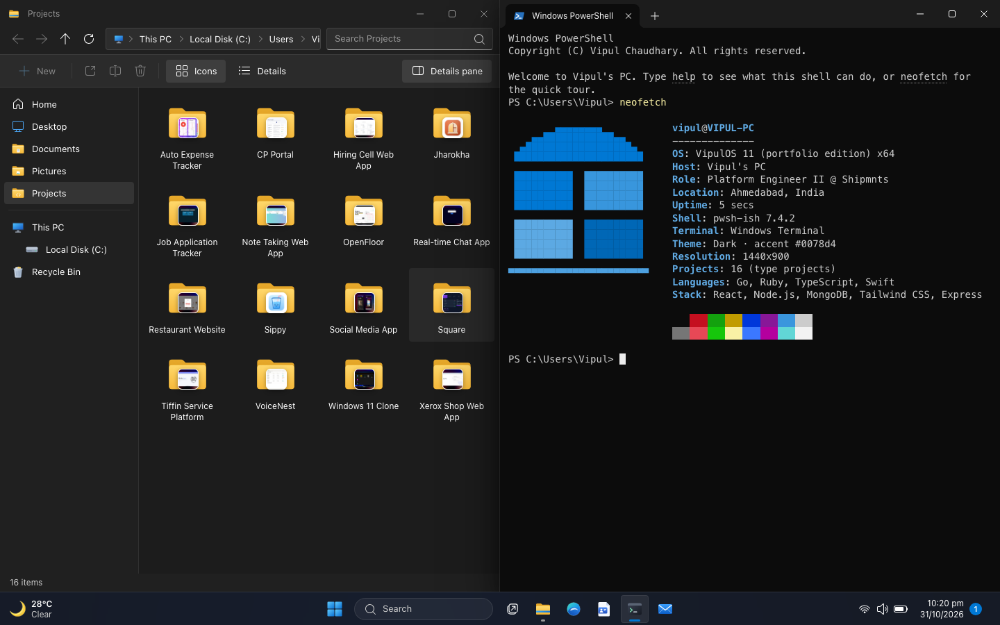
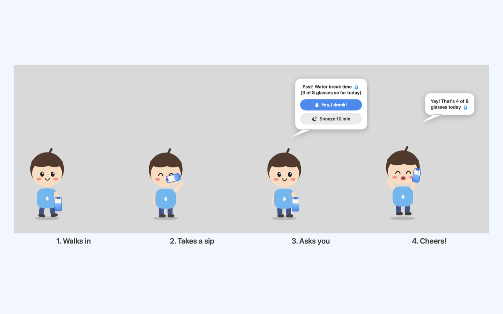
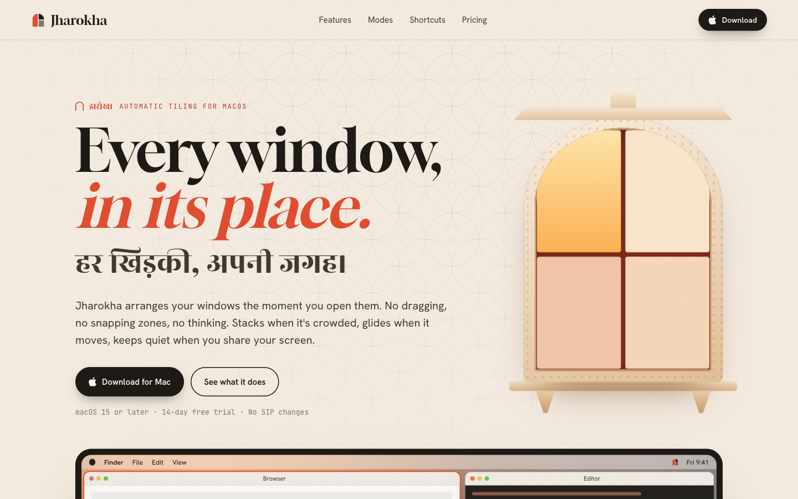
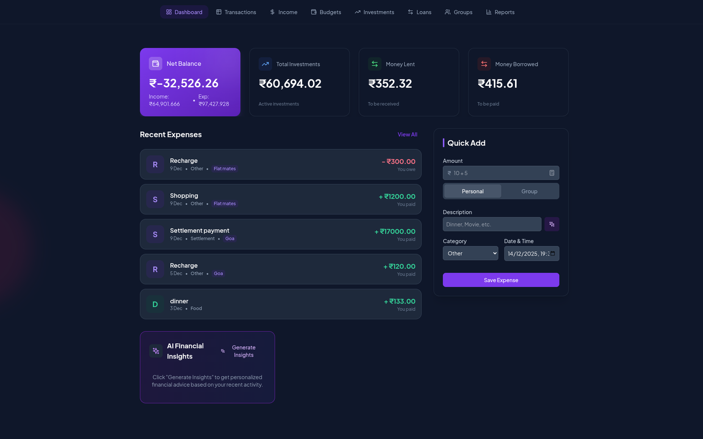

<div align="center">


**I build the plumbing of B2B SaaS: auth, event pipelines, CI and tooling.**<br/>
Right now that's a logistics platform used by 150+ companies and 3,000 people every day.

<a href="https://www.vipulchaudhary.in/"></a>
<a href="https://linkedin.com/in/vipulchaudhary16"></a>
<a href="mailto:contact.vipulchaudhary@gmail.com"></a>
<a href="https://x.com/fullstackvipul"></a>
<a href="https://medium.com/@vipulchaudhary16"></a>

</div>

<br/>

## ⚡ What I do at work

```yaml
role:     Platform Engineer II @ Shipmnts  (since 2024, intern → SDE → Platform)
domain:   multi-tenant logistics SaaS · 150+ enterprise tenants
```

- 🔐 **Auth for the whole platform.** Designed and own SSO across every tenant and service, built in Go and WorkOS with rotating refresh tokens and instant revocation. Used by 4+ services.
- 🧾 **Audit trail that can't lose events.** Built a central "who changed what, when and why" service on Kafka, a transactional outbox, CDC and append-only Postgres.
- 🚀 **CI twice as fast.** Cut end-to-end pipeline cold-start from 16.5 min to about 8 by rebuilding images and service boot order.
- 🧪 **No more manual regression testing.** Built and own the Playwright + Docker suite that gates every release and covers 100% of critical flows.
- 🤖 **GenAI that removed data entry.** Business-card photos become CRM leads (OCR + LangChain), and trade documents become structured data (Gemini).

<br/>

## 🛠️ Things I've built for fun

### [🏢 OpenFloor](https://openfloor.homes)
Check a Gujarat real-estate project before you book: which flats are still open, floor by floor, how far construction has come, the price range of unsold units, and whether the developer kept past deadlines. All from the official RERA record. Explore 17,000+ projects by city, compare projects and keep a wishlist with notes.

<sub>Next.js 16 · TypeScript · Tailwind · Firebase · Vercel</sub>

<a href="https://openfloor.homes"></a>

<a href="https://openfloor.homes"></a>

<table>
<tr>
<td width="50%" valign="top">

### [🪟 Window](https://github.com/vipulchaudhary16/window)
My portfolio as a Windows 11 desktop in the browser: draggable windows, a terminal, file explorer and start menu.

<sub>React 19 · TypeScript · Vite · Zustand</sub>

<a href="https://window11byvipul.netlify.app/"></a> <a href="https://github.com/vipulchaudhary16/window"></a>

<a href="https://github.com/vipulchaudhary16/window"></a>

</td>
<td width="50%" valign="top">

### [💧 Sippy](https://github.com/vipulchaudhary16/Sippy)
A native macOS menu-bar app. A tiny character walks onto your screen, takes a sip, and reminds you to drink water.

<sub>Swift · SwiftUI · AppKit</sub>

<a href="https://github.com/vipulchaudhary16/Sippy"></a>

<a href="https://github.com/vipulchaudhary16/Sippy"></a>

</td>
</tr>
<tr>
<td width="50%" valign="top">

### [🏯 Jharokha](https://jharokha.vipulchaudhary.in)
Automatic window tiling for macOS 15+. Every window gets a place as it opens, and the rest reflow when one closes. Named after the carved windows of Rajasthani palaces.

<sub>Swift · Accessibility APIs</sub>

<a href="https://jharokha.vipulchaudhary.in"></a> <a href="https://github.com/vipulchaudhary16/Jharokha"></a>

<a href="https://jharokha.vipulchaudhary.in"></a>

</td>
<td width="50%" valign="top">

### [💸 Square](https://square-split.netlify.app/)
An AI expense tracker and bill splitter with Redis-backed auth that detects stolen refresh tokens. Gemini gives spending insights.

<sub>Rails · Go · React · Flutter · PostgreSQL · Redis</sub>

<a href="https://square-split.netlify.app/"></a> <a href="https://github.com/vipulchaudhary16/Square"></a>

<a href="https://square-split.netlify.app/"></a>

</td>
</tr>
</table>

<br/>

## 🧰 Stack

<p align="center">
  <b>Daily drivers</b><br/><br/>
  
</p>
<p align="center">
  <b>Also comfortable with</b><br/><br/>
  
</p>

<br/>

## 🏆 Bits & pieces

- 🥇 First prize at **DotSlash 7.0** (SVNIT Surat) for an automated finance tracker
- 🧠 LeetCode max rating **1900+**, top 4% globally. My [DSA repo](https://github.com/vipulchaudhary16/data-structures-and-algorithms) has ⭐ 12
- 🎓 B.Tech CSE, PDEU, **9.59 CGPA**

<br/>

<div align="center">

<picture>
  <source media="(prefers-color-scheme: dark)" srcset="https://raw.githubusercontent.com/vipulchaudhary16/vipulchaudhary16/output/snake-dark.svg" />
  <source media="(prefers-color-scheme: light)" srcset="https://raw.githubusercontent.com/vipulchaudhary16/vipulchaudhary16/output/snake.svg" />
  
</picture>

<sub>💬 Open to interesting backend, platform and GenAI work. <a href="mailto:contact.vipulchaudhary@gmail.com">Say hi</a>.</sub>

</div>
